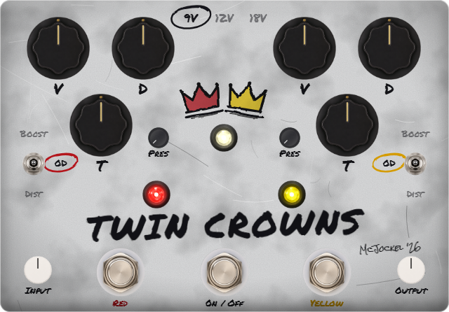

# Twin Crowns

Two overdrives in one box for the [pi-Stomp](https://github.com/TreeFallSound/pi-stomp) v3: an LV2 plugin
that runs the circuit model of [Monarch of Tone](https://github.com/tehguitarist/Monarch-of-Tone), a
circuit-accurate model of a famous boutique two-in-one Bluesbreaker-style overdrive.



Monarch of Tone (MoT) is a JUCE plugin for desktop hosts. Twin Crowns takes its circuit DSP
unchanged and wraps it in a plain LV2 plugin that mod-host and MOD-UI can run on the pi-Stomp,
with every control as an LV2 control port, so footswitches and encoders can be assigned to it.
The output is bit-identical to MoT's, also while controls change, which a null test against a
build of MoT checks.

## The pedal

- **Two channels in series:** Red (A) runs first, Yellow (B) second, each with its own
  footswitch. Both are the same circuit, except that Red has a fixed Hi-Gain mod.
- **Per channel:** Volume (V), Drive (D), Tone (T), Presence, and a three-way clipping switch:
  Boost, Overdrive or Distortion.
- **Global:** 9, 12 or 18 V supply, input and output trim, and the oversampling of the clipping
  stage (1×, 2×, 4× or 8×, default 4×) in MOD-UI's settings.
- **MoT's factory presets:** Blues, High Gain, Rhythm Crunch, Edge-of-Breakup and Fuzz.
- **Pedal GUI for MOD-UI**, with every control on the face. The face reads left to right like
  the pedalboard: Red on the left, Yellow on the right.

## Building and installing on the pi-Stomp

On the pi-Stomp, over SSH:

```sh
sudo apt install --no-install-recommends build-essential lv2-dev git
git clone <this repository> twin-crowns
cd twin-crowns
git submodule update --init      # not --recursive: MoT's JUCE isn't needed
make -j4
make test
make install                     # into ~/.lv2/twin-crowns.lv2
sudo systemctl restart mod-host mod-ui
```

Then reload MOD-UI in the browser. Twin Crowns is in the Distortion category. Restarting the
services interrupts audio and loads the last saved pedalboard.

The submodules use relative URLs: MoT and chowdsp_wdf come from the repositories next to this
one, which are forks pinned to the commits the build uses.

It also builds on other Linux systems with `g++` and `lv2-dev`; the Makefile adds
`-mcpu=cortex-a76` only on aarch64.

## Development

- `make test` checks the half-band oversampler against JUCE's coefficients, the signal path,
  bypass, trims and block handling, and that `third_party/chowdsp_wdf` is on the commit MoT pins.
- `make nulltest` compares the plugin with a build of MoT, sample for sample. Run
  `tests/nulltest/setup_reference.sh` once first; it builds MoT with JUCE outside this repo.
- `make deploy` builds and installs on a pi-Stomp reachable as the SSH host `pistomp`.
- [CLAUDE.md](CLAUDE.md) has the details on how the port follows MoT.

## Credits and licenses

Twin Crowns is Copyright (C) 2026 IgnatzMcJockel and licensed under the
[GNU Affero General Public License v3.0](LICENSE).

It builds on:

- [Monarch of Tone](https://github.com/tehguitarist/Monarch-of-Tone) by tehguitarist, AGPLv3: the circuit
  DSP, the factory presets and the art for knobs, switches, LEDs and footswitches. Used
  unchanged, as a submodule.
- [chowdsp_wdf](https://github.com/Chowdhury-DSP/chowdsp_wdf) by Chowdhury DSP, BSD 3-Clause,
  which MoT's circuit model is built on.
- [JUCE](https://juce.com) by Raw Material Software, used under the AGPLv3: the half-band
  oversampler in `src/HalfBandOversampler.h` is a port of JUCE's.
- The fonts Permanent Marker and Rock Salt by Font Diner, Apache License 2.0, see
  [modgui/LICENSE-fonts.txt](modgui/LICENSE-fonts.txt).

Developed with [Claude Code](https://claude.com/claude-code) (Anthropic).

Twin Crowns is an independent project. It is not affiliated with or endorsed by the author of
Monarch of Tone, the maker of the pi-Stomp or the maker of the pedal it models. Product names
belong to their owners.
